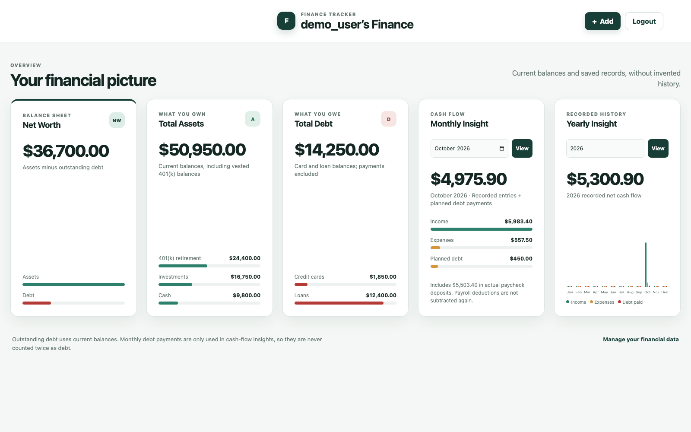
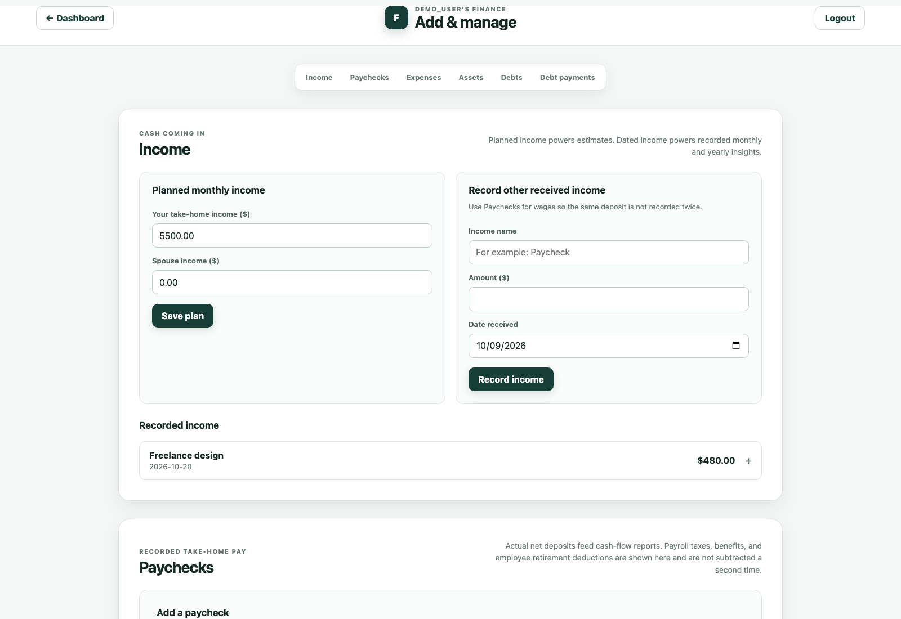

# Finance Tracker

[](https://github.com/aayush-dhg/finance-tracker/actions/workflows/ci.yml)

Finance Tracker is a local personal-finance dashboard and Python learning
project built with Flask and SQLite. It is intended for experimenting with
authentication, relational data, validation, financial calculations, and
responsive server-rendered interfaces—not for storing data on a public server.

## Screenshots

The screenshots use only fictional records generated by `demo_data.py`.





## Implemented and verified features

- Browser registration, login, POST-only logout, CSRF protection, hashed
  passwords, and independent accessible password visibility controls.
- Owner-scoped reads and writes: users cannot view, edit, or delete another
  user's financial records.
- A responsive five-card dashboard for net worth, assets, debt, monthly cash
  flow, and yearly recorded cash flow.
- Assets with category, reported balance, and balance date.
- Credit cards with balance, APR, planned minimum payment, and monthly due day.
- Auto, mortgage, personal, and individual loans with balances and planned
  payments.
- Planned monthly income, dated other-income records, recurring or dated
  expenses, and dated debt-payment history.
- Custom expense categories saved and suggested per user.
- Detailed paychecks with gross pay, itemized taxes, health insurance,
  employee 401(k), custom deductions, actual net deposit, and employer match.
- User-owned 401(k) accounts with reported vested/unvested balances and linked
  contribution history.
- Add, edit, and delete workflows with integer-cent money storage.
- Dependency-free per-client throttling after repeated failed login or
  registration attempts.

## Technology

- Python 3.11 and Flask (the current test environment)
- SQLite through Python's standard `sqlite3` module
- Flask-Login, Flask-WTF/CSRF, and Werkzeug password hashing
- Jinja templates, vanilla JavaScript, and responsive CSS
- Python `unittest` with isolated temporary databases
- Livereload for the local development server

## Fresh-clone setup

1. Clone the repository and enter it:

   ```bash
   git clone <your-repository-url>
   cd finance-tracker
   ```

2. Create and activate a virtual environment:

   ```bash
   python3 -m venv .venv
   source .venv/bin/activate
   ```

3. Install the pinned dependencies:

   ```bash
   pip install -r requirements.txt
   ```

4. Create local configuration from the safe template:

   ```bash
   cp .env.example .env
   ```

   Replace the placeholder `SECRET_KEY` in `.env` with a long random value.
   `.env` is ignored by Git; do not commit it.

5. Start the application:

   ```bash
   python dev.py
   ```

   Open <http://127.0.0.1:5001>. The SQLite schema and an empty `finance.db`
   are created automatically on first startup. The database is ignored by Git.

6. Choose **Create account** in the browser. New accounts start with zero
   planned income and no copied financial records. The terminal alternative is:

   ```bash
   python create_account.py
   ```

## Fictional demo database

Generate a completely separate, ignored `demo_finance.db` containing fictional
users and records:

```bash
python demo_data.py
FINANCE_DATABASE_PATH=demo_finance.db python dev.py
```

Sign in with the demo-only credentials printed by the script. The generator
refuses to write to `finance.db`, refuses to replace an existing demo database
by default, and never reads or copies normal user records. To deliberately
rebuild only `demo_finance.db`, run:

```bash
python demo_data.py --replace
```

## Financial calculation rules

- Money is converted to and stored as integer cents. APR is stored as integer
  basis points to avoid floating-point rounding in persisted values.
- **Expected paycheck net** = gross pay − federal/state/Social Security/
  Medicare/other taxes − health insurance − employee 401(k) − custom payroll
  deductions.
- **Recorded paycheck income** uses the actual net deposit, not gross pay or
  expected net. Payroll deductions are displayed for explanation and are not
  subtracted again from the actual deposit.
- **Employer 401(k) match** is contribution history, not spendable income, and
  does not reduce net pay. Employee and employer contributions do not
  automatically increase the account's reported balance.
- **Other income** is a separately dated name-and-amount record. Monthly and
  yearly recorded income add it to actual paycheck deposits for the matching
  dates. Entering a paycheck again as other income would double-count it.
- **Total assets** = saved asset balances + reported vested 401(k) balances.
  Unvested retirement balances and contribution totals are excluded.
- **Total debt** = current credit-card balances + current loan balances.
  Monthly payments are cash-flow amounts, not additional outstanding debt.
- **Net worth** = total assets − total debt.
- **Monthly insight** uses dated paycheck deposits, other income, and expenses
  when that month has recorded activity, then subtracts current planned card
  minimums and loan payments. With no dated activity, it is clearly labeled as
  a planned estimate using planned monthly income and recurring expenses.
- **Yearly insight** uses only dated paycheck deposits, other income, expenses,
  and recorded debt payments grouped by month. Planned income is not added to
  recorded yearly income, and missing history is not invented.

## Tests

Tests create SQLite databases inside temporary directories and do not modify
`finance.db` or `demo_finance.db`:

```bash
python -m unittest discover -s tests -v
```

The suite covers authentication and logout, hashing, CSRF, validation,
rate-limiting behavior, user isolation, financial calculations, month/year
grouping, paycheck deductions and retirement links, edit/delete recalculation,
migration preservation, and isolation of the fictional demo generator.

GitHub Actions runs the same Python 3.11 compilation and test commands for
every push to `main` and every pull request. The workflow has read-only
repository permissions and uses only temporary test databases.

## Privacy before publishing

- `.env`, SQLite files, backups, virtual environments, logs, caches, and test
  artifacts are ignored.
- Never use a real database to create examples or screenshots.
- Ignoring a file does not remove it from earlier Git commits. Review the full
  history before making a repository public and rotate any secret that was
  ever committed.

## Current limitations

- This is a local learning application, not production financial software.
- SQLite data is not encrypted at rest and there is no bank synchronization,
  transaction import, multi-factor authentication, or password-recovery flow.
- Authentication throttling is held in process memory, resets on restart, and
  is not suitable for multiple server instances.
- Balances are manually reported snapshots; the app does not calculate market
  returns, accrued interest, card statements, or amortization schedules.
- A due day is a recurring day number from 1–31, not a statement-specific due
  date; short months are not automatically adjusted.
- The development server is not configured for public internet deployment.

## Roadmap (not implemented)

- Safe local password-reset tooling and session invalidation.
- Import/export using a documented, validated interchange format.
- Debt statement/payment reconciliation and loan amortization views.
- A persistent shared rate limiter and hardened deployment configuration.
- Additional accessibility and cross-browser testing.

## Development note

AI coding tools assisted with implementation, review, test generation, and
documentation. The project remains a learning exercise: changes should be
reviewed, tests should be run locally, and financial/security assumptions
should be understood before use.
